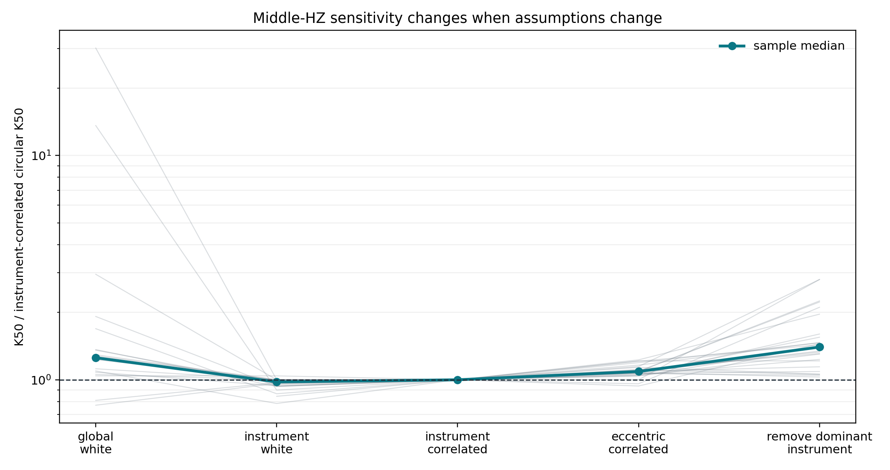
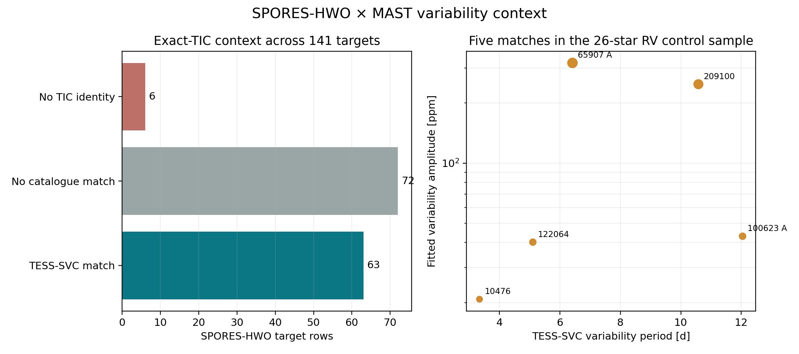
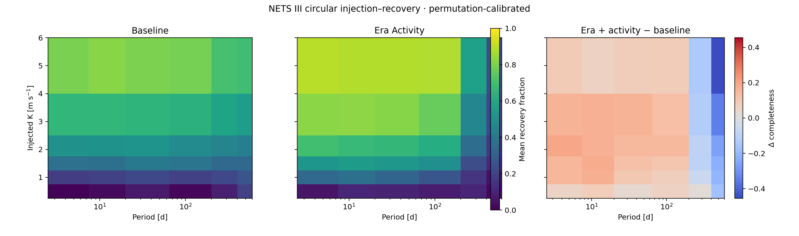
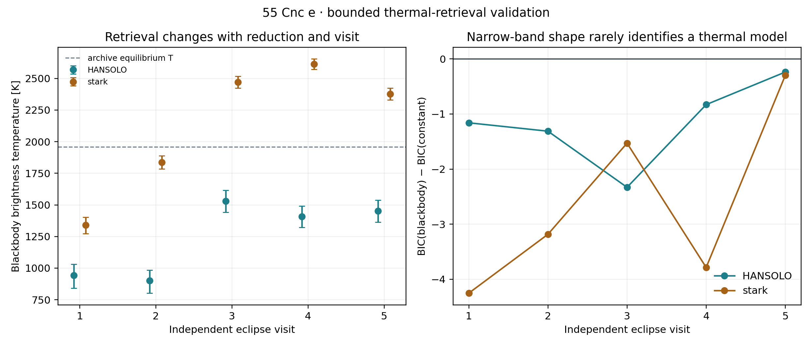

# Open Exoplanet Evidence Lab

[](https://github.com/Biswajit1999/open-exoplanet-discovery-lab/actions/workflows/tests.yml)
[](https://github.com/Biswajit1999/open-exoplanet-discovery-lab/actions/workflows/science-validation.yml)
[](https://github.com/Biswajit1999/open-exoplanet-discovery-lab/actions/workflows/web-build.yml)

**Biswajit Jana · public-data research release 0.4.0 · 12 October 2026**

[Research interface](https://biswajit1999.github.io/open-exoplanet-discovery-lab/) · [validated result record](research/RESULTS_2026-09-23.md) · [data-release registry](research/DATA_RELEASE_REGISTRY.md)

## Abstract

The Open Exoplanet Evidence Lab tests whether exoplanet inferences remain
stable when instrument zero points, stellar activity, cadence, orbital
geometry, wavelength and reduction provenance are modelled explicitly. This
release combines public VizieR radial velocities, NASA Exoplanet Archive
context, MAST variability data, ESO optical/NIR holdings, TESS photometry,
JWST atmospheric spectra and Gaia DR3 identities. It makes no new-planet or
atmospheric-composition claim.

The new result is a 26-star SPORES-HWO II robustness experiment using 8,260
nightly RV epochs. Under instrument offsets and a correlation-preserving null,
the median middle-habitable-zone K50 is 1.80 m s⁻¹. Relative to that reference,
eccentric injections raise median K50 by a factor of 1.09, a global white-noise
model by 1.25, and removal of the dominant instrument by 1.40. The experiment
uses 500 empirical-null permutations per model, 24 frozen orbital geometries
per amplitude and an amplitude grid extending to 20 times each published K50;
all finite-grid censoring states are retained.

## Validated results

### SPORES-HWO II: sensitivity is conditional on the observing model

VizieR catalogue `J/AJ/170/343` contains 141 target rows, 153,902 raw RV rows,
109 signal rows, 74 trend rows and 120 habitable-zone sensitivity rows from 28
instruments. A pre-declared control requires a published middle-HZ row, at
least 150 valid nightly RVs, at least two instruments and no catalogue table-6
signal. Twenty-six stars pass, contributing 8,260 nightly epochs.

Five models were evaluated at each star's published middle-HZ period: global
versus instrument offsets, white versus within-instrument circular-shift
nulls, circular versus eccentric injections, and a leave-dominant-instrument
stress test. The reference instrument-correlated circular model has median
K50 = 1.80 m s⁻¹ and median K90 = 2.48 m s⁻¹. Its K50 is bracketed for 24/26
stars and K90 for 25/26; values outside the grid are explicitly censored.



| Model | Median K50 (m s⁻¹) | Median K90 (m s⁻¹) | Median K50 / reference |
|---|---:|---:|---:|
| Global offsets, white null, circular | 2.08 | 2.83 | 1.25 |
| Instrument offsets, white null, circular | 1.75 | 2.33 | 0.98 |
| Instrument offsets, correlated null, circular | 1.80 | 2.48 | 1.00 |
| Instrument offsets, correlated null, eccentric | 1.88 | 2.94 | 1.09 |
| Dominant instrument removed, correlated null | 2.33 | 3.86 | 1.40 |

The selection is “no catalogue signal,” not “planet-free”: NASA archive
context identifies confirmed planets around 3/26 controls. Exact SIMBAD-to-TIC
linkage finds 63 TESS-SVC matches among all 141 target rows and 5/26 among the
controls. A non-match is not evidence of photometric quietness, and a match is
not assigned to rotation or a planet.



Machine-readable outputs:
[`results/spores_hwo_robustness_2026-10-12/`](results/spores_hwo_robustness_2026-10-12/),
[`results/spores_tess_svc_context_2026-10-12/`](results/spores_tess_svc_context_2026-10-12/), and
[`results/spores_tess_synthesis_2026-10-12/`](results/spores_tess_synthesis_2026-10-12/).

### NETS III: nuisance modelling changes the completeness surface

The public NETS III tables supply 5,920 RV rows for 41 survey stars. Forty
stars have at least 20 complete RV, uncertainty, run and S-index rows, yielding
5,782 measurements for injection/recovery. Across six periods, six amplitudes,
six phases and 100 deterministic residual permutations, the run-plus-activity
model changes mean completeness by +0.0205 but changes an individual grid cell
by as much as 0.4542. It improves short-period recovery while suppressing
sensitivity at 300–500 d.



| Period | Global-offset K50 (m s⁻¹) | Run-offset K50 (m s⁻¹) | Run + activity K50 (m s⁻¹) |
|---:|---:|---:|---:|
| 5 d | 2.00 | 1.57 | 1.43 |
| 10 d | 1.98 | 1.58 | 1.36 |
| 30 d | 1.93 | 1.56 | 1.43 |
| 100 d | 2.15 | 1.77 | 1.52 |
| 300 d | 2.38 | 4.04 | 3.80 |
| 500 d | 2.58 | not reached | not reached |

K90 is not reported numerically because the tested grid does not bracket 90%
population recovery. Machine-readable outputs:
[`results/nets3_completeness_2026-09-23/`](results/nets3_completeness_2026-09-23/).

### 55 Cnc e: the thermal retrieval is not reduction-stable

All 15 public Patel et al. (2024) products are used: five independent eclipse
visits, two reductions of each 3.95–4.92 μm spectrum, and five two-band
products. A planet/star blackbody model is fitted to each spectrum and compared
with a constant and a linear spectrum by BIC. Stellar-temperature sensitivity,
random-effects visit scatter and leave-one-visit-out prediction are retained.



The HANSOLO and stark reductions give mean brightness temperatures of
1249 ± 134 K and 2129 ± 237 K, respectively. For the same visits, the median
HANSOLO-minus-stark difference is −936 K. Reconciling visits requires 286 K
and 526 K of extra scatter; the largest held-out predictive discrepancy is
2.58σ. A blackbody has the lowest BIC for 8/10 spectra, while a linear model is
preferred for the other two. These outcomes diagnose model adequacy and
reduction sensitivity, not atmospheric composition.

No molecular-abundance posterior is reported because the public band is
narrow, its spectral covariance is unpublished, and the reductions share
photons. Machine-readable outputs:
[`results/atmosphere_retrieval_validation_2026-10-12/`](results/atmosphere_retrieval_validation_2026-10-12/).

### TESS, ESO and Gaia context

- HD 10780's strongest TESS periods are 5.762 d and 6.094 d. Analytic false
  alarms are tiny, but sector-preserving circular shifts give p = 0.950 and
  p = 0.0149. This is activity context, not a planet or secure rotation claim.
- A complete ESO TAP census contains 34,751 public NIRPS products across 852
  archive target identities. HARPS products occur for 696 identities, with 662
  having an epoch pair within one hour and 664 within one day. This is a product
  census; it is not yet a homogeneous chromatic-RV comparison.
- Exact SIMBAD resolution maps all 41 NETS III targets to distinct Gaia DR3
  source IDs. Gaia fields are identity/context only. Gaia DR4 remains gated
  until the release and archive schema are public.
- A deliberately restricted NEID-only circular model for HD 190360 returns
  K = 0.702 ± 0.048 m s⁻¹ at 88.69 d, compared with about 1.48 m s⁻¹ in the
  published multi-instrument analysis. It is retained as a model-adequacy
  warning, not a revised planet amplitude.

## Evidence and reproducibility

Every release directory contains configuration, source or query records,
machine-readable results and SHA-256 checksums. Raw third-party downloads are
kept out of Git when redistribution would be unnecessary; acquisition scripts
and exact identifiers remain reproducible. Synthetic injected values validate
software only and are never presented as astronomical measurements.

Python 3.10–3.12 is supported; the website CI uses Node 22.

```bash
python -m venv .venv
source .venv/bin/activate        # Windows PowerShell: .venv\Scripts\Activate.ps1
python -m pip install --upgrade pip
python -m pip install -e ".[test,archives,tess]"
pytest -q
python scripts/run_validation_suite.py --output outputs/validation
```

Build the research interface:

```bash
PYTHONPATH=src python scripts/build_web_release_data.py
cd web
npm ci
npm run build
```

The website consumes a compact contract generated only from frozen release
files. Publication-critical calculations stay in Python; the interface exposes
exact values, provenance, claim boundaries and downloadable result paths.
